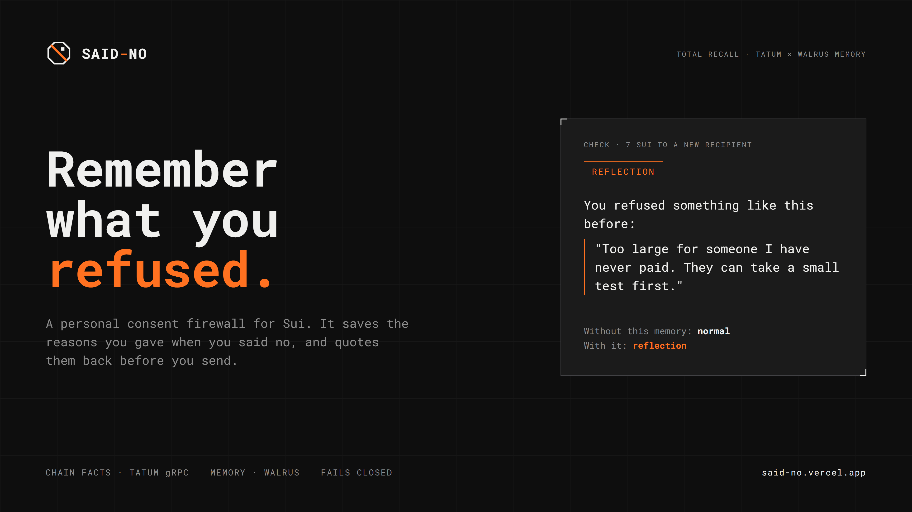
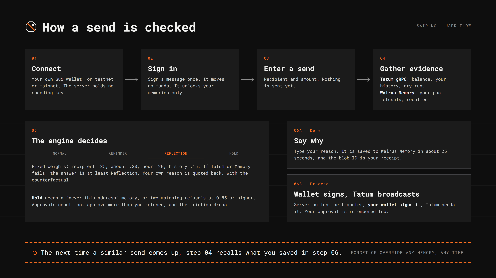
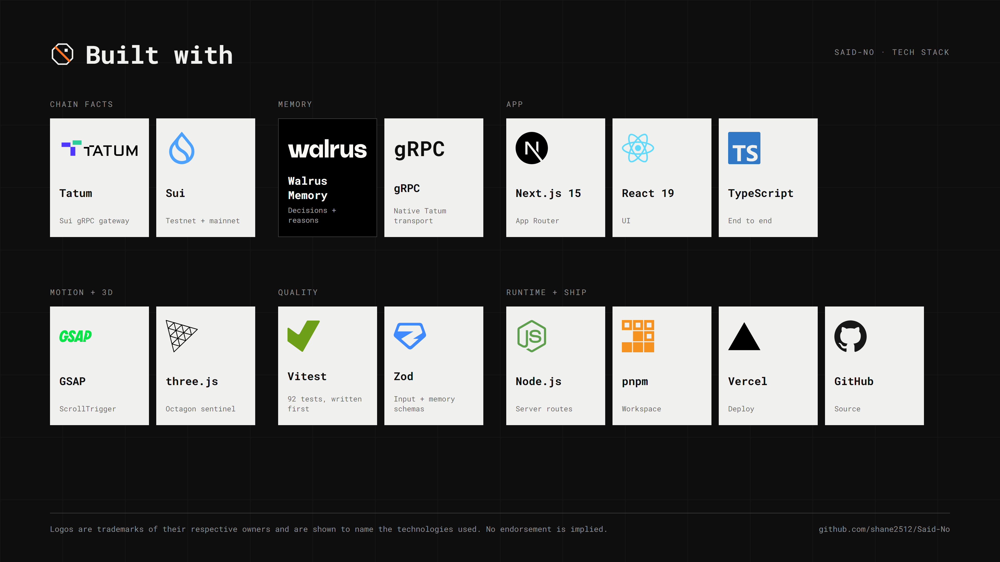

<div align="center">


# Said-No

**A personal consent firewall for Sui. It remembers the sends you refused, quotes your own reasons back, and adds friction in proportion to how much a new send resembles them.**

[Live demo](https://said-no.live) · [Memory Lab](https://said-no.live/lab) · [Docs](https://said-no.live/docs) · [Blog post](docs/blog-post.md) · [Walrus mainnet proof](#walrus-memory-writes-on-mainnet)

   

</div>

<p align="center"></p>

Built for the **Tatum x Walrus Memory "Total Recall" hackathon**. Tracks: **Consumer Finance** and **Best Walrus Memory**.

---

## Contents

- [The problem](#the-problem)
- [The solution](#the-solution)
- [Features](#features)
- [How it works](#how-it-works)
- [User flow](#user-flow)
- [Architecture](#architecture)
- [Tech stack](#tech-stack)
- [Walrus Memory writes on mainnet](#walrus-memory-writes-on-mainnet)
- [Getting started](#getting-started)
- [Configuration](#configuration)
- [API](#api)
- [Project structure](#project-structure)
- [Testing](#testing)
- [Security and privacy](#security-and-privacy)
- [Honest limits](#honest-limits)
- [Roadmap](#roadmap)
- [License and acknowledgements](#license-and-acknowledgements)

---

## The problem

Wallets are good at remembering what you **approved**: contracts you allowed, addresses you paid. They are blind to what you **refused**, and refusals are where your judgment shows.

On-chain sends are irreversible, and the mistakes people make are repetitive: a large amount to someone they have never paid, a rushed transfer at 2am, an address pasted from a chat that felt wrong an hour ago. Generic scam warnings don't help, because they don't know *you*. They can't say "you turned down almost exactly this last month, and here is why."

## The solution

Said-No is a consent firewall that learns from your own refusals.

1. **You say no, and say why.** Deny a send and type your reason. It is saved to **Walrus Memory**.
2. **It recognises the pattern.** The next time a send looks like one you refused, Said-No compares recipient, amount, time of day and history against your past decisions.
3. **It answers in your words.** It quotes your own reason back, with the blob ID as a receipt, and adds friction in proportion to the match.
4. **It shows its work.** Every verdict includes a counterfactual: what the answer would have been without your memory.

Live chain facts come from **Tatum's Sui gRPC gateway**, so "unusual amount" means unusual *for you*, measured from your own outgoing history.

## Features

| | |
|---|---|
| **Your reasons, quoted back** | Typed reasons are stored in Walrus Memory and returned verbatim, with the blob ID. |
| **Four friction levels** | `normal` → `reminder` → `reflection` → `hold`, chosen by a deterministic score. |
| **Counterfactual proof** | Each verdict shows what it would have been without the memory. |
| **Live chain facts** | Balance, outgoing history and a dry run through Tatum gRPC, on testnet or mainnet. |
| **Your own wallet** | Connect any Sui wallet. The server holds no spending key. |
| **Per-wallet memory** | Sign a message to unlock your own memories, kept in a separate namespace. |
| **Forget or override** | Delete any memory, or override any warning. You stay in control. |
| **Fails closed** | If Tatum or Memory is unreachable, the verdict is at least `reflection`, never a quiet `normal`. |
| **Memory Lab** | Inspect, add and forget what it remembers at `/lab`. |
| **Recorded run** | `/app` replays one real end-to-end run and re-computes it with the engine. |

## How it works

No model sits in the loop. Each remembered decision is compared to the send in front of you with **fixed weights**:

| Signal | Weight |
|---|---|
| Same recipient | 0.35 |
| Similar amount (rebased to your current usual amount) | 0.30 |
| Similar hour of day | 0.20 |
| Similar prior-interaction history | 0.15 |

The best match picks the level:

| Similarity | Level |
|---|---|
| below 0.40 | `normal` |
| 0.40 to 0.69 | `reminder` |
| 0.70 to 0.84 | `reflection` |
| a "never this address" memory, or two matching refusals at 0.85 or higher | `hold` |

Approvals count as evidence too: approve a kind of send more often than you refused it, and the friction drops. The same inputs always give the same verdict, and a test pins that down.

Two details that cost us bugs and are now covered by tests:
- **Amounts are stored as real amounts and rebased at check time.** Storing a ratio at save time made old memories go wrong as your usual amount changed.
- **A wallet with no history gets a neutral amount ratio**, not a division by zero.

## User flow

<p align="center"></p>

1. **Connect** your own Sui wallet (testnet or mainnet toggle).
2. **Sign in** with a message. It moves no funds; it only unlocks your memories.
3. **Enter a send.** Nothing is sent yet.
4. **Evidence:** Tatum gives balance, history and a dry run; Walrus Memory gives your past refusals.
5. **The engine decides** and shows its reasoning, your own words and the counterfactual.
6. **Deny** (save why, about 25 s on Walrus) or **proceed** (the server builds the transfer, your wallet signs it, Tatum broadcasts it).

The next check recalls what you saved.

## Architecture

```
                         ┌──────────────────────────────┐
  Browser                │  Next.js 15 (App Router)     │
  ┌──────────────┐       │                              │
  │ Sui wallet   │ sign  │  /api/session   sign-in      │
  │ (your keys)  │◄─────►│  /api/check     verdict      │
  └──────────────┘       │  /api/decide    save memory  │
        ▲                │  /api/build     unsigned tx  │
        │ approve        │  /api/broadcast signed tx    │
        │                └───────┬──────────────┬───────┘
        │                        │              │
        │              ┌─────────▼───┐   ┌──────▼────────────┐
        │              │ Tatum Sui   │   │ Walrus Memory     │
        │              │ gRPC        │   │ (mainnet relayer) │
        │              │ balance     │   │ per-wallet        │
        │              │ history     │   │ namespace         │
        │              │ dry run     │   │ remember / recall │
        │              │ execute     │   └───────────────────┘
        │              └─────────────┘
        │
        └── engine: similarity → level → counterfactual  (pure, tested)
```

- The **engine** is pure TypeScript with no I/O, so every verdict is reproducible and unit-tested.
- The **server never signs.** It checks, builds an unsigned transfer, and broadcasts what your wallet signed.
- **Memory is bound to a namespace inside the client**, so no request can read or write another wallet's memories.

## Tech stack

<p align="center"></p>

| Layer | Technology |
|---|---|
| Chain facts and broadcast | **Tatum** Sui native gRPC gateway via `@mysten/sui` v2 `SuiGrpcClient`, `@protobuf-ts/grpc-transport`, `@grpc/grpc-js` |
| Memory | **Walrus Memory** via `@mysten-incubation/memwal` |
| Wallet | `@mysten/dapp-kit-react` (Wallet Standard) |
| App | Next.js 15, React 19, TypeScript |
| Validation | Zod |
| Front-end motion | GSAP + ScrollTrigger, Lenis, three.js |
| Tests | Vitest (tests written first) |
| Tooling and hosting | pnpm, Node.js, Vercel, GitHub |

Why gRPC: Sui JSON-RPC is decommissioned, and Tatum's gateway speaks native gRPC only (grpc-web is rejected). `ListTransactions` is a server stream that needs a start checkpoint from `getServiceInfo`, because nodes prune old history. Calls are paced and retried for the 3 requests-per-second free plan.

## Walrus Memory writes on mainnet

12 writes through the mainnet relayer, signed by the project's delegate key. Recall returned 12 of 12.

| id | action | blob id |
|---|---|---|
| mainnet-01 | deny | [`ybIaw2ZXRsEHcJzWvBna-j3K7fsfcGoJL7uo0IBcf0Y`](https://walruscan.com/mainnet/blob/ybIaw2ZXRsEHcJzWvBna-j3K7fsfcGoJL7uo0IBcf0Y) |
| mainnet-02 | deny | [`OxQbNb0UJ3v82LocWUumD7R9TYxt7L5x0dXQpV9-acI`](https://walruscan.com/mainnet/blob/OxQbNb0UJ3v82LocWUumD7R9TYxt7L5x0dXQpV9-acI) |
| mainnet-03 | deny | [`HvvyYDikARil0S5U81hnYKAFvMzs1ntCRNnqiq9Wnyw`](https://walruscan.com/mainnet/blob/HvvyYDikARil0S5U81hnYKAFvMzs1ntCRNnqiq9Wnyw) |
| mainnet-04 | deny | [`a42nGp1RgdLv5bSYX0rs_Uk0IZ48d0vgoVDH0kqczSA`](https://walruscan.com/mainnet/blob/a42nGp1RgdLv5bSYX0rs_Uk0IZ48d0vgoVDH0kqczSA) |
| mainnet-05 | deny (hard) | [`CDidQc6C3sjZXXlur2UYScztwEYUxlZRNKo1YPsmG_E`](https://walruscan.com/mainnet/blob/CDidQc6C3sjZXXlur2UYScztwEYUxlZRNKo1YPsmG_E) |
| mainnet-06 | deny | [`orq4vy9PmWXemMcyKiVKpEWWvStfOQ9dEVObGbjVpBw`](https://walruscan.com/mainnet/blob/orq4vy9PmWXemMcyKiVKpEWWvStfOQ9dEVObGbjVpBw) |
| mainnet-07 | approve | [`MbJSvApnqBAena960rT0uOUk5EysaEunKcW0dNAS4Yw`](https://walruscan.com/mainnet/blob/MbJSvApnqBAena960rT0uOUk5EysaEunKcW0dNAS4Yw) |
| mainnet-08 | override | [`jDJMFl5P_v-ss4-D31qrW_kGt2xxpRbtDHdL1Kfcv94`](https://walruscan.com/mainnet/blob/jDJMFl5P_v-ss4-D31qrW_kGt2xxpRbtDHdL1Kfcv94) |
| mainnet-09 | approve | [`ktRPVNYOr4HcuoUWPSAF6uErNa-YKHvajyWTcBXyZCw`](https://walruscan.com/mainnet/blob/ktRPVNYOr4HcuoUWPSAF6uErNa-YKHvajyWTcBXyZCw) |
| mainnet-10 | deny | [`qZCafu7p7nMGTvpmeBBeHcBt6AxgiDL0Oz6WynDse7I`](https://walruscan.com/mainnet/blob/qZCafu7p7nMGTvpmeBBeHcBt6AxgiDL0Oz6WynDse7I) |
| mainnet-11 | deny | [`I9PI0ts-e3CVv2XV2FIGX2-DlpKefRkYSs5ZlWr_RYk`](https://walruscan.com/mainnet/blob/I9PI0ts-e3CVv2XV2FIGX2-DlpKefRkYSs5ZlWr_RYk) |
| mainnet-12 | delete of mainnet-04 | [`WokGBWkO1fQuz17MkscRPUOHbPLMhqifca1-IABhlas`](https://walruscan.com/mainnet/blob/WokGBWkO1fQuz17MkscRPUOHbPLMhqifca1-IABhlas) |

Account: `0x9cde8e86a1ec3d9eb94ccd67dbe724fd22efea262611ff5dc1816c6ac903ebba` · Delegate public key: `0aa4807d2454583e5059f38b8c6edde18d193d3c22479c6b70c57bb0c49e7d39`

**Read this before judging these:** the 12 entries were drafted with an AI assistant as example decisions. They prove the writes; they are not months of real use. They are labelled `real` at the account owner's choice and live in the project's own namespace, so the app does not show them to visitors. The script is [`scripts/seed-mainnet.ts`](scripts/seed-mainnet.ts) and the text is in [`src/lib/seed-data.ts`](src/lib/seed-data.ts).

## Getting started

**Prerequisites:** Node.js 20 or later, pnpm, a [Tatum](https://tatum.io) API key, and a Walrus Memory account with a delegate key. A Sui wallet extension such as Slush for the browser.

```bash
git clone https://github.com/shane2512/Said-No.git
cd Said-No
pnpm install
cp .env.example .env     # then fill in the values below
pnpm dev                 # http://localhost:3000
```

**No keys yet?** Run it against an in-memory backend so nothing touches Walrus:

```bash
node scripts/dev-local.mjs
```

Other commands:

```bash
pnpm test         # 92 tests
pnpm typecheck
pnpm build
```

## Configuration

| Variable | Required | Purpose |
|---|---|---|
| `NETWORK` | no | Default chain: `testnet` (default) or `mainnet`. The page can toggle it per visitor. |
| `TATUM_API_KEY` | yes | Tatum key for testnet. |
| `TATUM_API_KEY_MAINNET` | for mainnet | Tatum key used when the network is mainnet. |
| `MEMWAL_ACCOUNT_ID` | yes | Walrus Memory account object ID. |
| `MEMWAL_DELEGATE_KEY` | yes | Delegate private key. Server only. Never commit it. |
| `SESSION_SECRET` | no | Signs wallet sessions. Falls back to the delegate key. |
| `NEXT_PUBLIC_DAPP_NAME` | no | App name shown by the Slush wallet when connecting. Defaults to `Said-No`; keep it equal to the page title and deployment name. |
| `NEXT_PUBLIC_SITE_URL` | no | Public URL of the deployment (metadata and wallet identity). Defaults to `https://said-no.live`. |
| `ALLOW_EXECUTE` | no | `true` lets the server build and broadcast sends. |
| `ALLOW_WRITES` | no | `true` lets visitors save decisions in production. Defaults on outside production. |
| `MEMORY_BACKEND` | no | `local` keeps decisions in process instead of Walrus. |

Never prefix any of these with `NEXT_PUBLIC_`. To copy a local `.env` to Vercel, run `node scripts/vercel-env.mjs` yourself; it never prints values.

## API

| Route | Purpose | Auth |
|---|---|---|
| `POST /api/session` | Trade a signed sign-in message for a short-lived token | Wallet signature |
| `POST /api/check` | Verdict for a send: facts, matches, counterfactual | Optional token (memories need it) |
| `POST /api/decide` | Save a decision to the wallet's own memory (about 25 s) | Token |
| `GET /api/jobs/:id` | Blob ID once a save lands; `202` until then | Token |
| `GET /api/memories` | The signed-in wallet's own decisions | Token |
| `POST /api/build` | Re-check, then build an unsigned transfer for your wallet to sign | None (gated server-side) |
| `POST /api/broadcast` | Submit a wallet-signed transaction through Tatum | None |
| `GET /api/status` | What this deployment can do. No secrets | None |

All routes except `/api/status` are rate-limited per visitor. Full details are at [`/docs`](https://said-no.live/docs).

## Project structure

```
src/
  lib/            engine, features, Tatum + chain, memory, sessions, runtime, rate limit
  app/api/        route handlers (check, decide, build, broadcast, session, ...)
  app/            pages: landing, /app, /lab, /docs
  components/     landing (GSAP + three.js) and site (check, lab, docs, wallet)
tests/            Vitest, one file per module
scripts/          spikes (live checks), dev servers, Vercel env, brand build
fixtures/         the recorded end-to-end run
docs/             design spec, plan, spike results, blog post
brand/            logos, posters, brand board
```

## Testing

92 tests, written before the code they cover. They include:

- engine verdicts and edge cases (empty history, rebased amounts, hold thresholds)
- fail-closed behaviour when Tatum or Memory errors
- memory round-trips and malformed-memory handling
- per-wallet namespace binding, which a regression test now guards
- wallet sign-in: forged, expired and cross-wallet tokens are refused
- privacy gating and rate limiting

Live checks live in `scripts/spikes/`. Results of every verified run, including digests and blob IDs, are logged in [docs/spike-results.md](docs/spike-results.md). One run against the live site used two throwaway wallets against real Walrus and caught a namespace leak, which was fixed the same day.

## Security and privacy

- **No server-held spending key.** Your wallet signs; the server only checks, builds and broadcasts.
- **More signals, no quizzes.** Tatum's address list (`GET /v3/security/address/{address}`, works with Sui addresses) holds a listed recipient. A burst of sends, or a new recipient with a large amount, gets a one-line reminder. After 3+ refusals the factor weights shift toward what you actually react to, and your habits are stated in plain words. An optional "what is it for?" note is matched by meaning against your past reasons using Walrus Memory's own similarity.
- **Fails closed.** Missing chain facts or memory never produce a quiet `normal`.
- **Send gate.** Sends are capped at 0.1 SUI, need an acknowledgement above `normal`, and need a passing dry run.
- **Sign-in tokens** are HMAC-signed, expire, and are bound to one address.
- **Rate limiting** per visitor on every route except status.
- **Secrets** stay server-side and are never printed by any script.
- **Not a vault.** Memories sit in the project's Walrus account, separated per wallet by namespace, so the operator can read them. Do not store anything you would not want the operator to see.

## Honest limits

- Tatum reads and sends work on testnet and mainnet. Testnet sends were run repeatedly. **One real mainnet send** (0.0000001 SUI, [digest](https://suiscan.xyz/mainnet/tx/2xVuyxj3L4YGVxKVbaVrfkwGJNrDww61GFtd7ondLDGy)) was made from the live app and checked on-chain: the recipient received exactly that amount, and the sender also paid the network fee of about 0.0011 SUI. That is one small transaction, not a load test.
- The 12 mainnet memories are drafted examples, as noted above.
- Walrus Memory recall is semantic only, so each decision is stored as a sentence plus a JSON line and matched in code. Writes take about 25 seconds.
- Memory always uses the mainnet relayer; the staging relayer is down. So the same memories apply on testnet and mainnet.
- Said-No adds friction. It cannot stop a determined user, and it is not financial advice.
- Much of this code was written with an AI coding assistant (Claude Code).

## Roadmap

Ideas, not promises:

- Exercise mainnet sends more widely (only one small send so far).
- Encrypt memories to the wallet so the operator cannot read them.
- Import and export of a wallet's memories.
- Reason-aware matching, so a refusal can generalise beyond the exact recipient.

## License and acknowledgements

MIT. See [LICENSE](LICENSE).

Logos, posters and the brand board are in [`brand/`](brand/). Third-party logos are trademarks of their owners and are shown only to name the technologies used.

Thanks to **Tatum** for the Sui gRPC gateway, **Walrus** and Mysten Labs for Walrus Memory and the Sui SDKs, and the organisers of the Total Recall hackathon.
